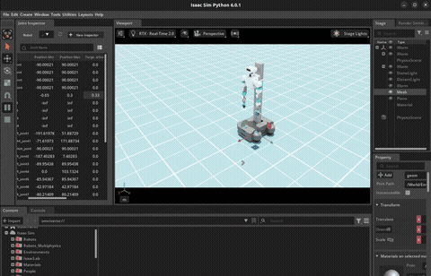

[中文说明](README_CN.md)

# openflex_sim_Isaac



Isaac Sim assets for the OpenFlex wheeled humanoid. Ready-to-use robot and scene USD files are included in this repository.

## Quick Start

Prerequisites: Isaac Sim is installed and the NVIDIA driver is working. ROS 2, URDF generation, and USD conversion are not required to open the provided scene.

```bash
git clone <repo-url> openflex_sim_Isaac
cd openflex_sim_Isaac

export ISAAC_SIM_PYTHON=/path/to/isaacsim/python.sh
"$ISAAC_SIM_PYTHON" scripts/open_scene.py
```

For an Isaac Sim installation at `/home/openflex/isaacsim`:

```bash
export ISAAC_SIM_PYTHON=/home/openflex/isaacsim/python.sh
"$ISAAC_SIM_PYTHON" scripts/open_scene.py
```

The launcher opens Isaac Sim with its UI and loads:

```text
artifacts/usd/scenes/openflex_empty_stage.usda
```

The scene includes the OpenFlex robot, a physics scene, grid ground, and base lighting.

Optional headless validation:

```bash
"$ISAAC_SIM_PYTHON" scripts/open_scene.py --headless true --frames 300
```

## Using the Asset

### Adjust Joints

Open `Tools > Robotics > Joint Inspector` and select `/World/OpenFlex` from the robot picker.

- Arms, head, steering, and lift: edit `Target Position`
- Four wheels: edit `Target Velocity`
- Drive tuning: edit `Stiffness`, `Damping`, and `Max Force`

Press Play after changing targets. Revolute joints use angular targets; the lift and fingers use linear position targets.

### Cameras and LiDAR

The generated USD includes these RTX sensors:

- Chassis D435: `ChassisD435/RgbCamera` for RGB
- Chassis D435: `ChassisD435/DepthCamera` for `distance_to_image_plane` depth
- Head Femto Bolt: `HeadCamera/RgbCamera` for RGB
- `mid360_link`: `Mid360Lidar/PointCloud` for point-cloud source data

Open `Tools > Sensors > Camera Inspector`, select an RGB camera, and click `Create Viewport` to view its stream.

Depth frames and LiDAR point clouds are read by Isaac Sim runtime sensor pipelines: `CameraSensor` with the `distance_to_image_plane` annotator, and `LidarSensor` with `generic-model-output`. ROS 2 integration can publish those as image, `CameraInfo`, and `PointCloud2` topics.

`mid360_link` is a LiDAR mount, not a millimeter-wave radar. It currently uses the official Isaac Sim `Example_Solid_State` LiDAR as an operational baseline. The official USD is network-referenced, so the first load requires access to Isaac Sim assets.

## Assets

```text
artifacts/usd/robots/openflex_integrated_robot/openflex_integrated_robot.usda
artifacts/usd/scenes/openflex_empty_stage.usda
```

Both assets can be opened or referenced directly from Isaac Sim. Keep the `artifacts/usd/` directory layout intact because the scene references the robot USD by a relative path.

## Rebuild Assets

This section is only for maintainers updating robot descriptions or regenerating USD. It is not required for normal use of the checked-in assets.

`uv` manages the local tooling environment, while Isaac Sim's `python.sh` runs scripts requiring Isaac Sim APIs.

```bash
uv sync
uv run scripts/sync_from_workspace.py --clean
uv run scripts/build_urdf.py
"$ISAAC_SIM_PYTHON" scripts/build_usd.py
```

To pull configured upstream source packages instead of syncing a local ROS workspace:

```bash
uv run scripts/update_from_upstream.py --clean
uv run scripts/build_urdf.py
"$ISAAC_SIM_PYTHON" scripts/build_usd.py
```

Pass `--headless false` to `build_usd.py` to show the Isaac Sim UI during import.

## Layout

```text
artifacts/        Generated URDF and ready-to-use USD assets
packages/         Snapshot of robot description packages
scripts/          Scene launcher and asset build tools
configs/          Source repository configuration
```

## Scripts

- `scripts/open_scene.py`: open the provided Isaac scene
- `scripts/sync_from_workspace.py`: sync description packages from a local ROS workspace
- `scripts/update_from_upstream.py`: fetch and sync upstream description packages
- `scripts/build_urdf.py`: generate the intermediate URDF
- `scripts/build_usd.py`: regenerate USD with the Isaac Sim URDF Importer

## References

- [Isaac Sim URDF Importer](https://docs.isaacsim.omniverse.nvidia.com/6.0.0/importer_exporter/ext_isaacsim_asset_importer_urdf.html)
- [Isaac Sim Standalone Python](https://docs.isaacsim.omniverse.nvidia.com/6.0.0/python_scripting/manual_standalone_python.html)
- [Isaac Sim Joint Inspector](https://docs.isaacsim.omniverse.nvidia.com/latest/robot_setup/joint_inspector.html)
- [Isaac Sim Camera Sensors](https://docs.isaacsim.omniverse.nvidia.com/latest/sensors/isaacsim_sensors_camera.html)

## Current Status

This is an initial release. Many physical parameters are estimates and require further calibration against hardware data and simulation tests. Chassis and upper-body inverse-kinematics (IK) solvers are not integrated yet.

## License

This work is licensed under the Creative Commons Attribution-NonCommercial-ShareAlike 4.0 International License (CC BY-NC-SA 4.0).

Copyright (c) 2026 Chengdu Changshu Robot Co., Ltd. (成都长数机器人有限公司)

For more details, see the [LICENSE](LICENSE) file or visit: http://creativecommons.org/licenses/by-nc-sa/4.0/

## Acknowledgments

This package is part of the OpenArmX robotic platform ecosystem, developed for research and industrial applications in collaborative robotics.

---

## 📞 Contact Us

### Chengdu Changshu Robot Co., Ltd.

| Contact           | Information                                                                                                  |
| ----------------- | ------------------------------------------------------------------------------------------------------------ |
| 📧 Email          | [openarmrobot@gmail.com](mailto:openarmrobot@gmail.com)                                                      |
| 📱 Phone / WeChat | +86-17746530375                                                                                              |
| 🌐 Website        | [https://openarmx.com/](https://openarmx.com/)                                                               |
| 🌐 Documentation  | [http://docs.openarmx.com/](http://docs.openarmx.com/)                                                               |
| 📍 Address        | Huacheng Machinery Plant, No.11 Xinye 8th Street, West Area, Tianjin Economic-Technological Development Area |
| 👤 Contact Person | Mr. Wang 
